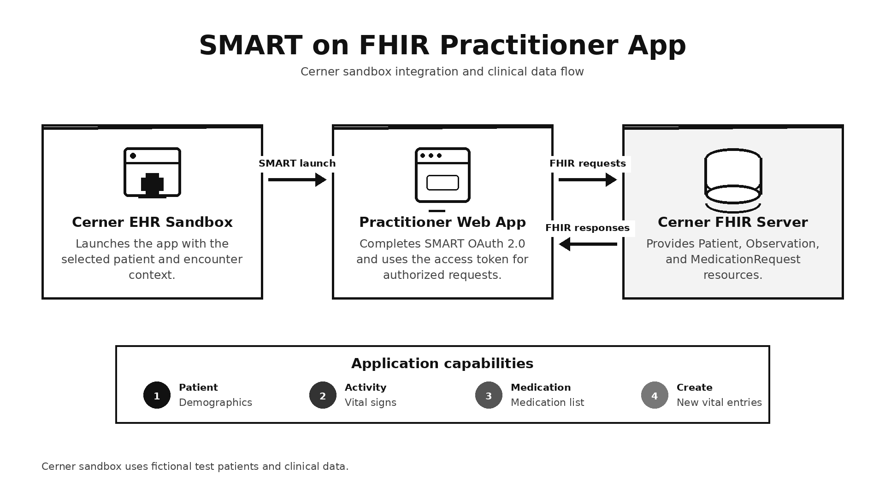

# SMART on FHIR Practitioner App

**Demo**: https://youtu.be/24yFwA0FIA0?si=1kTFtTV7d0QuFCvc

## Description

This project is a practitioner-facing SMART on FHIR web application designed to launch within the Cerner EHR sandbox. It uses the SMART App Launch framework and OAuth 2.0 to receive the active patient context, authorize access, and interact securely with clinical data through FHIR APIs.

The application allows practitioners to:

- View the selected patient's demographic information.
- Retrieve and display vital signs from FHIR `Observation` resources.
- Retrieve and display medications from `MedicationRequest` resources.
- Create new vital-sign entries for the selected patient.


The authorization flow begins when Cerner launches the application with `iss` and `launch` parameters. The application retrieves the EHR's SMART configuration, redirects the practitioner to the authorization endpoint, exchanges the returned authorization code for an access token, and uses that token for authorized FHIR requests.



## Technologies Used

- **Angular**
- **TypeScript**
- **SMART on FHIR**
- **OAuth 2.0**
- **HL7 FHIR R4**
- **Cerner SMART on FHIR Sandbox**

## FHIR Resources

- **Patient**: Displays patient demographics and identifying information.
- **Observation**: Retrieves vital signs and submits new vital-sign entries.
- **MedicationRequest**: Retrieves the patient's prescribed medications.

## Authentication and Data Flow

1. Cerner launches the application with the FHIR server URL and a launch token.
2. The application retrieves the SMART on Cerner configuration.
3. The practitioner is redirected through the SMART OAuth 2.0 authorization flow.
4. The application exchanges the authorization code for an access token and patient context.
5. The application uses the token to request permitted FHIR resources.
6. Patient demographics, vital signs, and medications are displayed in the application.
7. Practitioners can submit new vital-sign observations to the FHIR server.

## Running the Project

1. Clone the repository.
2. Install dependencies:

   ```bash
   npm install
   ```

3. Configure the application's client ID, redirect URI, scopes, and Cerner sandbox launch settings.
4. Start the Angular development server:

   ```bash
   ng serve
   ```

5. Launch the application through the configured Cerner SMART on FHIR sandbox workflow.

> The Cerner sandbox contains fictional test patients and clinical data. No real patient information should be used in this project.

---

Feel free to contribute or reach out with any feedback or questions.
